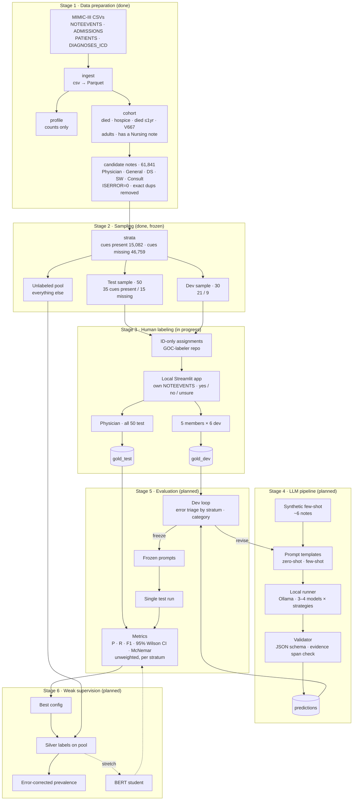

# Architecture — GOC Detection in MIMIC-III (Pilot, Milestone 1)

Stages 1–3 are built. Stages 4–6 are **planned**. Their modules and record shapes below are a
sketch, and the design still has to be approved (see CLAUDE.md §6).

## Pipeline overview



---

## Modules and data contracts

Every stage reads from and writes to `data/`, which is gitignored. No stage prints note text.

### Built

| Module | Input | Output | Prints |
|---|---|---|---|
| `ingest/load.py` | `data/raw/<table>/*.csv*` | `data/parquet/<table>.parquet` | row counts per table |
| `ingest/profile.py` | parquet | `reports/profile.json` | category counts, discharge locations, V667 count |
| `cohort/build.py` | parquet | `derived/cohort.parquet` (SUBJECT_ID, HADM_ID, ADMITTIME, reason flags) | count per inclusion reason |
| `cohort/candidates.py` | cohort + NOTEEVENTS | `derived/candidates.parquet` (ROW_ID, SUBJECT_ID, HADM_ID, CATEGORY, DESCRIPTION, CHARTDATE, CHARTTIME, n_chars, TEXT) | count per category |
| `sampling/cues.py` | — | cue + probe regex patterns | — |
| `sampling/cue_frequency.py` | candidates | `reports/cue_frequency.json` | matches per phrase × category |
| `sampling/strata.py` | candidates | `derived/strata.parquet` (ROW_ID, SUBJECT_ID, HADM_ID, CATEGORY, n_chars, stratum, cues) | stratum × category table |
| `sampling/draw.py` | strata, seed 20261016 | `derived/{test,dev}_sample.parquet` (… stratum, n_chars, label_order) | sizes; asserts patient-disjoint; refuses overwrite |
| `labeling/assign.py` | test/dev samples | `data/assignments/{test_physician,dev_A..dev_E}.parquet` (ROW_ID, CATEGORY, n_chars, label_order) | notes per file |
| `labeling/export_kit.py` | assignments + app code | GOC-labeler repo (code, README, `assignments/*.csv`) | file names |
| `labeling/app.py` | assignment + labeler's own NOTEEVENTS | `<assignment>_<INITIALS>.jsonl` | — (local UI) |
| `labeling/collect.py` | assignments + label files | — | labeled / missing per assignment, invalid lines |

### Planned (design not yet approved)

| Module | Input | Output | Prints |
|---|---|---|---|
| `llm/run.py` | ids, model, strategy | `predictions/{model}_{strategy}_{set}.jsonl` | throughput, parse failures |
| `llm/validate.py` | predictions + notes | adds `span_verified` | % valid JSON, % spans verified |
| `eval/metrics.py` | gold + predictions | `reports/{set}_metrics.json` | metrics table |
| `eval/triage.py` | dev gold + predictions + strata | `reports/dev_errors.json` | errors by stratum, category |
| `weak/silver.py` | pool ids, frozen config | `predictions/silver_pool.jsonl` | label distribution |

### Label record (human, `labeling/schema.py`)

```json
{
  "row_id": 0,
  "assignment": "dev_A",
  "goc_present": "yes | no | unclear",
  "annotator": "AB",
  "minutes_spent": 2.5,
  "labeled_at": "2026-10-16T00:00:00+00:00"
}
```

Latest record per `row_id` wins. `unclear` is shown to labelers as "unsure".

### Prediction record (planned, shared by every model × strategy)

```json
{
  "row_id": 0,
  "method": "llama3-8b",
  "strategy": "few_shot",
  "goc_present": "yes | no | unclear",
  "evidence_span": "...",
  "span_verified": true,
  "raw_output_path": "predictions/raw/....txt",
  "latency_s": 4.2
}
```

Every model × strategy writes this same shape, so `eval/` treats them identically. Prediction
files may contain note text (`evidence_span`) and stay under `data/`.

---

## Isolation boundaries

```
src/sampling/  ──X──>  src/eval/        (import forbidden; enforced by tests/test_eval_independence.py)
gold_test      ──X──>  dev loop         (test never read before prompts are frozen)
synthetic      ──────>  prompts          (only source of few-shot examples)
note text      ──X──>  anyone else      (labelers use their own MIMIC download; only IDs and labels move)
```

---

## Repos

| Repo | Holds | Who |
|---|---|---|
| github.com/dennisdang5/GOC-pilot (private) | full pipeline, reports (aggregates), source of the labeling code | project |
| github.com/dennisdang5/GOC-labeler (private) | exported app, README, ID-only assignments, returned label files | physician + 5 members |

---

## Milestone 1 → stages

| Stage | Delivers |
|---|---|
| 1–2 Data prep + sampling | Candidate pool, 50 test / 30 dev samples |
| 3 Human labeling | Physician gold standard (test), member labels (dev) |
| 4–5 LLM pipeline + evaluation | Model × strategy metrics with 95% CIs |
| 6 Weak supervision | Silver labels on the pool, error-corrected prevalence |

Future work (not built): component-level content analysis, keyword-baseline comparison.
