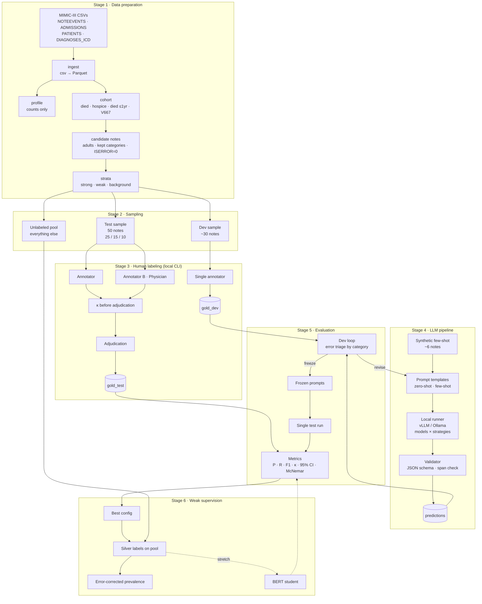

# Architecture — GOC Detection in MIMIC-III (Pilot, Milestone 1)

## Pipeline overview



---

## Modules and data contracts

Every stage reads from and writes to `data/`. No stage prints note text.

| Module | Input | Output | Prints |
|---|---|---|---|
| `ingest/load.py` | `data/raw/<table>/*.csv*` | `data/parquet/<table>.parquet` | row counts per table |
| `ingest/profile.py` | parquet | `reports/profile.json` | category counts, discharge locations, V667 count |
| `cohort/build.py` | parquet | `derived/cohort.parquet` (SUBJECT_ID, HADM_ID, reason flags) | count per inclusion reason |
| `cohort/candidates.py` | cohort + NOTEEVENTS | `derived/candidates.parquet` (ROW_ID, HADM_ID, CATEGORY, TEXT) | count per category |
| `sampling/strata.py` | candidates | `derived/strata.parquet` (ROW_ID, stratum) | stratum × category table |
| `sampling/draw.py` | strata, seed | `derived/{test,dev,pool}_ids.parquet` | sizes; asserts disjoint |
| `labeling/cli.py` | sample ids + parquet | `labels/{annotator}_{set}.jsonl` | progress only |
| `labeling/adjudicate.py` | two annotator files | `labels/gold_test.jsonl`, `reports/agreement.json` | κ per field |
| `llm/run.py` | ids, model, strategy | `predictions/{model}_{strategy}_{set}.jsonl` | throughput, parse failures |
| `llm/validate.py` | predictions + notes | adds `span_verified` | % valid JSON, % spans verified |
| `eval/metrics.py` | gold + predictions | `reports/{set}_metrics.json` | metrics table |
| `eval/triage.py` | dev gold + predictions | `reports/dev_errors.json` | errors by `negative_reason`, `goc_type`, stratum |
| `weak/silver.py` | pool ids, frozen config | `predictions/silver_pool.jsonl` | label distribution |

### Prediction record (shared by every method)

```json
{
  "row_id": 0,
  "method": "qwen-14b",
  "strategy": "few_shot",
  "goc_present": "yes",
  "evidence_span": "...",
  "span_verified": true,
  "negative_reason": null,
  "goc_type": "family_meeting",
  "raw_output_path": "predictions/raw/....txt",
  "latency_s": 4.2
}
```

Every model × strategy writes this same shape, so `eval/` treats them identically.

---

## Isolation boundaries

```
src/sampling/  ──X──>  src/eval/        (import forbidden; enforced by test)
gold_test      ──X──>  dev loop         (test never read before prompts are frozen)
synthetic      ──────>  prompts          (only source of few-shot examples)
```

---

## Milestone 1 → stages

| Stage | Delivers |
|---|---|
| 1–2 Data prep + sampling | Candidate pool, 50 test / ~30 dev samples |
| 3 Human labeling | Gold standard + inter-annotator κ |
| 4–5 LLM pipeline + evaluation | Model × strategy metrics with 95% CIs |
| 6 Weak supervision | Silver labels on the pool, error-corrected prevalence |

Future work (not built): component-level content analysis, keyword-baseline comparison.
