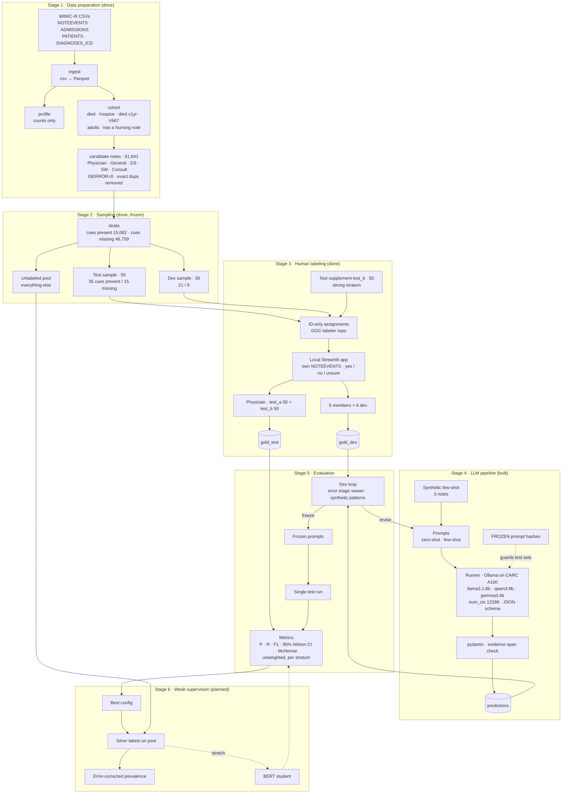

# Architecture — GOC Detection in MIMIC-III (Pilot, Milestone 1)

Stages 1–4 are built. Stages 5–6 are **planned**. Their modules below are a sketch, and the design
still has to be approved (see CLAUDE.md §6).

## Pipeline overview



---

## Modules and data contracts

Every stage reads from and writes to `data/`, which is gitignored. No stage prints note text.

### Built

| Module | Input | Output | Prints |
|---|---|---|---|
| `ingest/load.py` | `data/raw/<table>/*.csv*` | `data/parquet/<table>.parquet` | row counts per table |
| `ingest/profile.py` | parquet | `reports/profile.json` | category counts, discharge locations, V667 count |
| `cohort/build.py` | parquet | `derived/cohort.parquet` (SUBJECT_ID, HADM_ID, ADMITTIME, reason flags) | count per inclusion reason |
| `cohort/candidates.py` | cohort + NOTEEVENTS | `derived/candidates.parquet` (ROW_ID, SUBJECT_ID, HADM_ID, CATEGORY, DESCRIPTION, CHARTDATE, CHARTTIME, n_chars, TEXT) | count per category |
| `sampling/cues.py` | — | cue + probe regex patterns | — |
| `sampling/cue_frequency.py` | candidates | `reports/cue_frequency.json` | matches per phrase × category |
| `sampling/strata.py` | candidates | `derived/strata.parquet` (ROW_ID, SUBJECT_ID, HADM_ID, CATEGORY, n_chars, stratum, cues) | stratum × category table |
| `sampling/draw.py` | strata, seed 20261016 | `derived/{test,dev}_sample.parquet` (… stratum, n_chars, label_order) | sizes; asserts patient-disjoint; refuses overwrite |
| `sampling/yield_report.py` | candidates, strata, admissions, label files | `reports/yield_report.json` | yes/n per stratum, cue, cue-family count, timing, candidate rule |
| `sampling/strong.py` | — | cue families + `is_strong` rule (≥2 families AND ≤7 d to death / hospice dc) | — |
| `sampling/draw_supplement.py` | strata, candidates, admissions, test/dev samples, seed 20261026 | `derived/test_b_sample.parquet` (same columns, stratum `strong`) | pool size, sizes; asserts patient-disjoint; refuses overwrite |
| `labeling/assign.py` | test/dev/test_b samples | `data/assignments/{test_physician,test_physician_b,dev_A..dev_E}.parquet` (ROW_ID, CATEGORY, n_chars, label_order) | notes per file |
| `labeling/export_kit.py` | assignments + app code | GOC-labeler repo (code, README, `assignments/*.csv`) | file names |
| `labeling/app.py` | assignment + labeler's own NOTEEVENTS | `<assignment>_<INITIALS>.jsonl` | — (local UI) |
| `labeling/collect.py` | assignments + label files | — | labeled / missing per assignment, invalid lines |
| `llm/schema.py` | — | `LLMOutput` (evidence_span → goc_present yes/no), `Prediction` | — |
| `llm/prompts.py` | `prompts/system.txt`, `prompts/user.txt`, `fewshot.jsonl` (synthetic) | chat messages per strategy, prompt hash | — |
| `llm/notes.py` | sample parquets, candidates | ROW_IDs per set, TEXT in memory | — |
| `llm/run.py` | model, strategy, set (`dev \| test_a \| test_b`) | `predictions/{model}_{strategy}_{set}.jsonl` + `predictions/raw/` | counts, latency, error types, ROW_IDs |
| `llm/validate.py` | prediction files | — (`span_verified` is filled by run) | n, errors, % spans verified |
| `eval/metrics.py` | gold (that set's label files only) + predictions + sample strata | `reports/eval_{set}.json`, `reports/errors_{set}_{config}.csv` (ROW_IDs) | metrics, McNemar, ROW_IDs |
| `eval/report_md.py` | `reports/eval_{set}.json` | `reports/results_{set}.md` (no ROW_IDs) | — |
| `eval/triage_app.py` | dev gold + predictions + candidates (Streamlit, localhost, dev only) | `data/triage/dev_patterns.jsonl` (user's notes, gitignored) | — (UI only; never writes labels) |

### Planned (design not yet approved)

| Module | Input | Output | Prints |
|---|---|---|---|
| `weak/silver.py` | pool ids, frozen config | `predictions/silver_pool.jsonl` | label distribution |

### Label record (human, `labeling/schema.py`)

```json
{
  "row_id": 0,
  "assignment": "dev_A",
  "goc_present": "yes | no | unclear",
  "annotator": "AB",
  "labeled_at": "2026-10-16T00:00:00+00:00"
}
```

Latest record per `row_id` wins. `unclear` is shown to labelers as "unsure".

### Prediction record (`llm/schema.py`, shared by every model × strategy)

```json
{
  "row_id": 0,
  "method": "llama3.1:8b",
  "strategy": "zero_shot | few_shot",
  "set": "dev | test_a | test_b",
  "goc_present": "yes | no | null (only when error is set)",
  "evidence_span": "... | null",
  "span_verified": "true | false | null (no span)",
  "prompt_hash": "12 hex chars",
  "prompt_tokens": 3120,
  "truncated": false,
  "latency_s": 2.3,
  "raw_output_path": "data/predictions/raw/<stem>/<row_id>.json",
  "error": "null | parse | truncated"
}
```

Append-only; the latest record per `row_id` wins.

Every model × strategy writes this same shape, so `eval/` treats them identically. Prediction
files may contain note text (`evidence_span`) and stay under `data/`.

---

## Isolation boundaries

```
src/sampling/  ──X──>  src/eval/        (import forbidden; enforced by tests/test_eval_independence.py)
gold_test      ──X──>  dev loop         (test never read before prompts are frozen)
synthetic      ──────>  prompts          (only source of few-shot examples)
note text      ──X──>  anyone else      (labelers use their own MIMIC download; only IDs and labels move)
```

---

## Repos

| Repo | Holds | Who |
|---|---|---|
| github.com/dennisdang5/GOC-pilot (private) | full pipeline, reports (aggregates), source of the labeling code | project |
| github.com/dennisdang5/GOC-labeler (private) | exported app, README, ID-only assignments, returned label files | physician + 5 members |

---

## Milestone 1 → stages

| Stage | Delivers |
|---|---|
| 1–2 Data prep + sampling | Candidate pool, 50 test / 30 dev samples, 50-note enriched test_b |
| 3 Human labeling | Physician gold standard (test), member labels (dev) |
| 4–5 LLM pipeline + evaluation | Model × strategy metrics with 95% CIs |
| 6 Weak supervision | Silver labels on the pool, error-corrected prevalence |

Future work (not built): component-level content analysis, keyword-baseline comparison.
